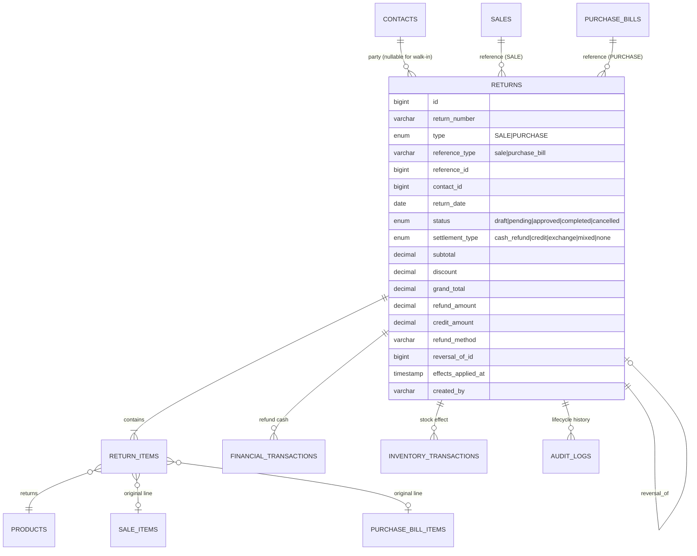
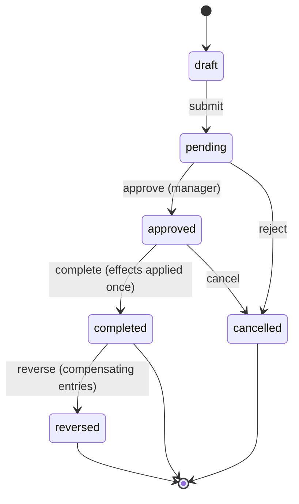
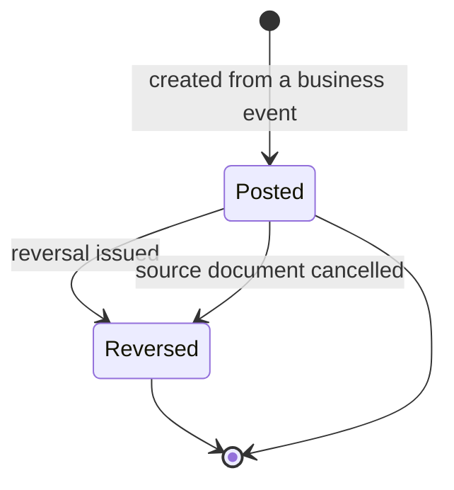
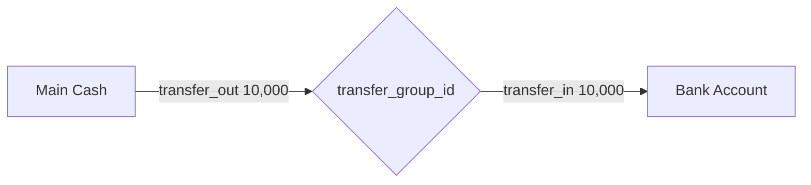
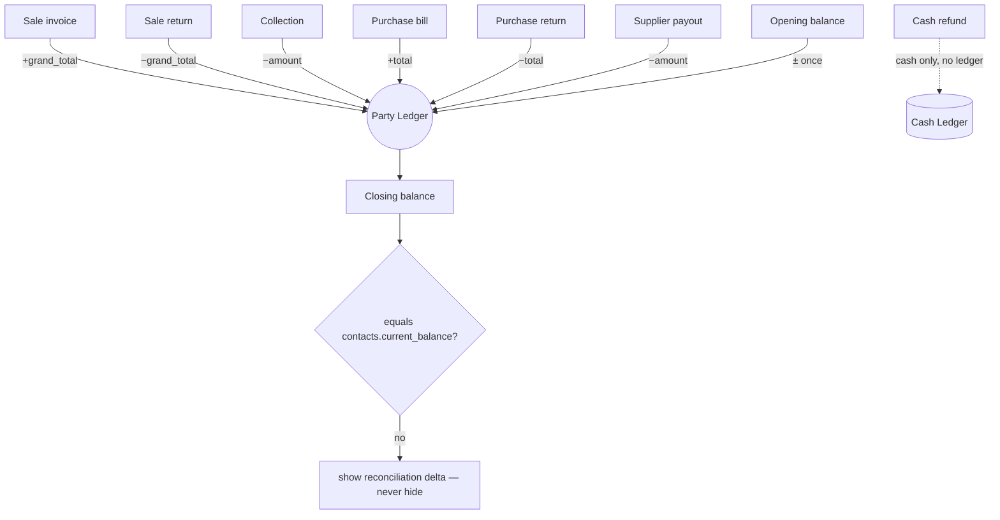
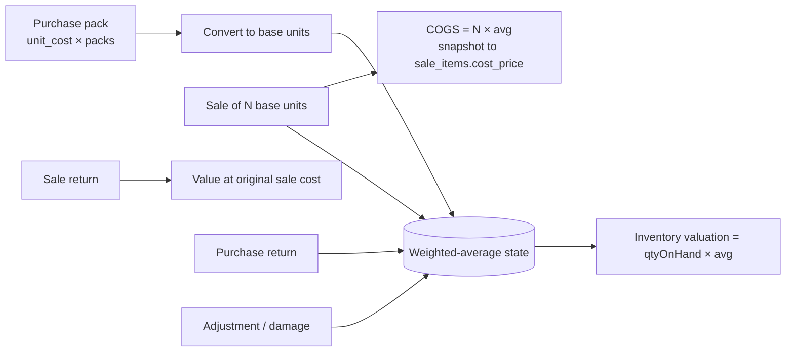
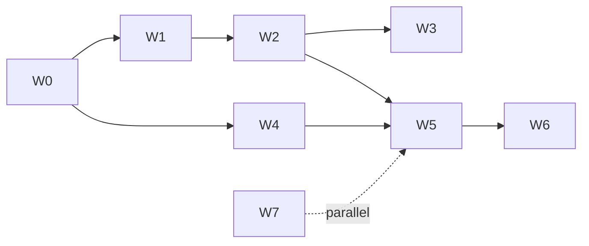

# Phase 0 — Financial Integrity Assessment & Target Architecture

**Repository:** `invenos-backend` · **Branch:** `master` · **HEAD:** `0ee9592`
**Date:** 2026-11-01
**Status:** Investigation and architecture only. No code, migrations, records, services, controllers or frontend changes were made.

**Evidence method.** `graphify-out/graph.json` + `GRAPH_REPORT.md` (built from `d0e397a`; HEAD `0ee9592`, so 2 commits stale → navigation only), then line-level verification in source, plus a structural profile of `.commandcode/khalsapansar_pos.sql`. Archived docs in `docs/` were checked; several contradict current code and are not treated as evidence.

**Tag legend:** **[CONFIRMED]** verified in source or snapshot · **[INFERRED]** strongly supported, not directly measured · **[RECOMMENDATION]** proposed design · **[UNKNOWN]** needs business input.

---

## 1. Executive Summary

**The single most important finding is that Invenos, as deployed, is a walk-in retail POS with no parties, no purchases, no returns, and no financial transactions.** The snapshot contains 54 sales and ~676 products, and **zero rows** in `contacts`, `purchase_bills`, `expenses`, `returns`, `return_items`, and `financial_transactions`. **[CONFIRMED — snapshot only; live confirmation pending]**

That changes the priority order. The original plan spent most of its effort on party statements, balance sheets and receivables that **no record in the snapshot uses**. Meanwhile the things that *do* carry this business — walk-in cash sales, returns, and stock valuation — are the parts that are broken.

**Four structural problems must be fixed before any report is trustworthy:**

1. **Returns have no working path.** The UI writes to in-memory mocks (`bootstrap.ts:9-27`), `ReturnService::completeReturn()` is never called, and it would fatal if called (`TransactionEngine.php:138` calls the private `InventoryService::applyMovement()`, `InventoryService.php:206`; its insert omits NOT NULL `date`/`reference`). **[CONFIRMED]**
2. **Cash has no authoritative record.** Walk-in sales create **no** `financial_transactions` row (`SaleService.php:182` is guarded by `if ($customer)`), yet they are the only sales that exist. "Financial transactions = cash" would report **zero cash** for this business. **[CONFIRMED]**
3. **The cost basis is likely wrong by the pack factor.** Purchases store `last_purchase_cost = unitCost` (`PurchaseService.php:132`) where `unitCost` is per purchase pack (`subtotal = Σ unitCost × purchaseQuantity`, line 85) and stock is in base units (`baseQuantity = packQty × purchaseQuantity`, line 108). Unless every pack is quantity 1, inventory value and COGS are inflated by the pack size. **[INFERRED — needs the 50-row sample query in §2.4]**
4. **The schema in the repo does not match the deployed schema.** Migrations declare money as `decimal(…, 12)` (scale 0): `create_sales_table.php:18-22`, `create_contacts_table.php:22-24`, `create_financial_transactions_table.php:17`, `create_returns_table.php:27-30`. The snapshot declares `decimal(12,2)` throughout. A fresh `migrate` would produce a **different database** than production. **[CONFIRMED — snapshot vs migrations]**

**Bottom line:** proceed with Phase 0 diagnostics and the returns/cash/inventory foundations. Defer the balance sheet, party statements and cash-flow statements until the data that feeds them exists.

---

## 2. Actual Production Database Profile

### 2.1 Method and limitation

Live DB access is not available in this session (read-only tooling is restricted, and no DB credentials are surfaced). Everything below labelled **snapshot** comes from importing/reading `.commandcode/khalsapansar_pos.sql`.

**A snapshot is not production.** It may be stale, partial, or scrubbed. Every count below must be re-run against the live DB with the query pack in Appendix A before any migration is authorised.

### 2.2 Snapshot profile — headline counts

| Dataset | Snapshot result | Evidence | Status |
|---|---|---|---|
| `sales` | **54 rows**; all sampled `customer_id = NULL`, `customer_name = 'Walk-in Customer'` | `sales` INSERT block, lines 3258-3274+ | CONFIRMED (snapshot) |
| `sale_items` | Many rows, 2 insert batches | lines 3344, 3658 | CONFIRMED |
| `contacts` | **0 rows** — no `INSERT INTO contacts` in dump | schema at 165, no insert block | CONFIRMED (snapshot) |
| `purchase_bills` | **0 rows** — no insert block | schema at 3031 | CONFIRMED (snapshot) |
| `expenses` | **0 rows** — no insert block | schema at 197 | CONFIRMED (snapshot) |
| `financial_transactions` | **0 rows** — no insert block | schema at 263 | CONFIRMED (snapshot) |
| `returns` | **0 rows** | schema at 3084, no insert | CONFIRMED (snapshot) |
| `return_items` | **0 rows** | schema at 3115, no insert | CONFIRMED (snapshot) |
| `RET-%` sales | **0** | grep `'RET-` → 0 matches | CONFIRMED |
| `PRET-%` purchases | **0** | grep `'PRET-` → 0 matches | CONFIRMED |
| `products` | ids observed up to 676 | product inserts, lines 2101-2780 | CONFIRMED (≤676 rows) |
| `inventory_transactions` | Multiple large insert batches; all early rows `type='adjustment'` | lines 308-1800 | CONFIRMED (count pending) |
| Business settings | `Khalsa Pansar Store`, PKR, `Asia/Karachi`, `stock_valuation_method: "fifo"` | settings insert, line 4785 | CONFIRMED |

### 2.3 Snapshot profile — data characteristics that matter

- **Zero-value sales exist.** Rows 1, 2, 6-11, 14, 16 have `discount = subtotal` and `grand_total = 0.00`, yet `payment_status = 'paid'`. Discount and payment status are **client-supplied** (`CreateSaleRequest` rules, `CreateSaleData::fromRequest`) and never recomputed server-side. **[CONFIRMED]**
- **`amount_paid` is client-declared**, not derived: `CreateSaleData` reads `$data['amount_paid'] ?? 0` and `$data['payment_status'] ?? 'paid'`; `SaleService` stores them unchanged (lines 97-99). Nothing rejects `amount_paid > grand_total`. **[CONFIRMED]**
- **Inventory history begins with manual "INITIAL" adjustments** (`reference='INITIAL'`, `reference_type='product'`), not purchases. Any cost-based valuation of opening stock has **no recorded cost**. **[CONFIRMED]**
- **Units are heterogeneous**: movements recorded in `kg`, `g`, `piece`, `packet`, `bottle` (lines 309-335). `products.base_unit_id` is a string, not an FK (`create_products_table.php`). **[CONFIRMED]**

### 2.4 What the live DB must establish (queries in Appendix A)

| Area | Questions that remain unanswerable from the snapshot |
|---|---|
| Returns | Do `returns`/`return_items` rows exist? Are there `RET-%`/`PRET-%` documents? Do they have inventory movements or FTs? |
| Financial transactions | Type/direction distribution, totals, date spread, duplicates, opening adjustments, invoice-vs-cash split |
| Contacts | Customer/supplier counts, non-zero opening/current balances, negative balances, reconciliation failures |
| Inventory | Whether `stock_quantity == SUM(movements)` per product; negative stock; missing costs; pack-vs-base cost samples |
| Payments | Collection/payout counts; FTs whose amount exceeds the linked sale's `amount_paid` |

**Do not proceed on the snapshot alone.** It shows a business shape, not production truth.

---

## 3. Confirmed Data Integrity Issues

| # | Issue | Evidence | Severity |
|---|---|---|---|
| DI-1 | Returns never persist; UI writes to mock stores | `resources/js/application/bootstrap.ts:9-27`, `ReturnPage.tsx:186-222` | **Critical** |
| DI-2 | Return completion path is unreachable and would fatal | `ReturnService.php:253` (no caller), `TransactionEngine.php:138` → `InventoryService.php:206` private | **Critical** |
| DI-3 | Return FT insert omits NOT NULL `date` and `reference` | `TransactionEngine.php:157-167` vs migration 2026_07_25_204234 | **Critical** |
| DI-4 | Walk-in sales create no financial transaction | `SaleService.php:182` guarded by `if ($customer)`; all snapshot sales are walk-in | **Critical** |
| DI-5 | Legacy returns (`RET-`/`PRET-`) have no route | `routes/web.php:89-118` (GET only); `SaleReturnService`/`PurchaseReturnService` unused by routes | High |
| DI-6 | Legacy returns never touch party balance or FTs | `SaleReturnService.php:40-86`, `PurchaseReturnService.php:29-100` | High |
| DI-7 | Reports count `RET-`/`PRET-` as sales/purchases | `SalesReportService.php:16-54` (no exclusion), `PurchaseReportService.php` | High |
| DI-8 | Payment deletion leaves the invoice "paid" | `PaymentController.php:129-138` | High |
| DI-9 | Generic payment decrements balance in both directions | `PaymentController.php:108` | Medium |
| DI-10 | Sales/purchase deletion reverses `grand_total`, not `outstanding_balance` | `SalePolicy.php:73`, `PurchasePolicy.php:87` | High |
| DI-11 | Opening balance exists twice (column + `OPENING` adjustment FT) and only the column feeds balance | `CreateContactData.php:53`, `ContactService.php:38-48` | High |
| DI-12 | `current_balance` has 8+ writers and no recomputation | grep results across `app/` | High |
| DI-13 | `last_purchase_cost` likely stored per pack | `PurchaseService.php:85, 108, 132` | High (INFERRED) |
| DI-14 | `payment_status`/`amount_paid` client-controlled, no server reconciliation | `CreateSaleRequest.php:20-32`, `CreateSaleData.php:37-40` | High |
| DI-15 | `stock_valuation_method: "fifo"` configured but not implemented | settings row 4785; no FIFO code anywhere | Medium |
| DI-16 | Schema drift: migrations declare money `decimal(12,0)`, deployed snapshot is `decimal(12,2)` | migrations vs dump tables `sales`, `contacts`, `financial_transactions`, `returns` | Medium (blocks safe migration) |
| DI-17 | `payments.print` route → missing `printReceipt()` | `routes/web.php:86` vs `PaymentController.php:114` | Medium |
| DI-18 | `reports.share.download` route → missing `download()` | `routes/web.php:165`, `ReportShareController.php` | Medium |
| DI-19 | Low-stock export capped at page 1 (25 rows) | `InventoryReportService.php:236`, `ReportController.php:334` | Medium |
| DI-20 | `config('app.timezone')` is UTC; business timezone is Asia/Karachi | `config/app.php`, settings row 4785 | Medium |

---

## 4. Canonical Returns Architecture

### 4.1 Decision

**Yes — make `returns` / `return_items` canonical.** They already model the right concepts (`type`, `reference_type/id`, `status`, `grand_total`, `refund_amount`, `refund_method`, soft deletes) and are the only structure that can carry both sale and purchase returns without abusing `sales`/`purchase_bills`. Retire the two legacy services. **[RECOMMENDATION]**

### 4.2 The value/refund/credit split — the core modelling rule

A return has **three independent amounts**, and conflating them is what makes the current system wrong:

| Field | Meaning | Example |
|---|---|---|
| `grand_total` | Commercial value of goods returned (what the credit note is worth) | 5,000 |
| `refund_amount` | Cash actually paid out to the customer (or received from the supplier) | 2,000 |
| `credit_amount` | Value retained as party credit (`grand_total − refund_amount`) | 3,000 |

Rules:
- Inventory and revenue reversal use **`grand_total`**.
- Cash ledger uses **`refund_amount`** only.
- Party balance uses **`grand_total`** (invoice reduction); the cash refund is settlement, not a second balance change.
- `credit_amount` is **not** a separate cash event — it is the residual on the party account.
- Invariants: `0 ≤ refund_amount ≤ grand_total`; `credit_amount = grand_total − refund_amount`; `settlement_type` explains the intent.

**[RECOMMENDATION]** Add `credit_amount` (generated/stored) and `settlement_type enum('cash_refund','credit','exchange','mixed','none')`.

### 4.3 Domain model



### 4.4 Lifecycle



- **Editable:** `draft`, `pending` (items, quantities, settlement).
- **Immutable:** `approved` onward. Corrections require cancel-before-complete or reverse-after-complete.
- **`effects_applied_at`** guarantees idempotency: the completion handler refuses to run twice.
- **`reversal_of_id`** points at the original; a reversal is a new return with negative-effect semantics (or a status flip plus compensating ledger rows — recommend the explicit reversal row for auditability).

**[RECOMMENDATION]** Keep `pending/completed/cancelled` for backward compatibility and add `draft`, `approved`, `reversed`. A migration backfills `approved`→`completed` only if effects exist; otherwise `pending`.

### 4.5 Stock movement rules

| Case | Movement | Cost basis |
|---|---|---|
| Sale return, `restock = true` | `inventory_transactions.type='sale-return'`, `+base_qty` | Original `sale_items.cost_price` |
| Sale return, `restock = false` | `type='damage'`, `+base_qty` then immediately `−base_qty` (or a single `damage` note) | Original cost, written off |
| Purchase return, goods shipped back | `type='purchase-return'`, `−base_qty` | Current weighted average |
| Purchase return, supplier rejects / goods kept | **no movement** | — |
| Exchange | two movements (return + replacement sale) | per leg |

Never reuse `type='return'` for both directions — the current `InventoryReportService::stockMovement()` (lines 345-353) and `periodStatsByProduct()` (482-488) already have to guess the sign because of it.

### 4.6 Party balance rules

| Party | Effect |
|---|---|
| Customer | `current_balance −= grand_total` (receivable reduced by the credit note) |
| Supplier | `current_balance −= grand_total` (payable reduced) |
| Cash refund | **no balance effect** — it settles part of the credit |
| Credit retained | remains as negative balance (customer advance) or reduced payable |

### 4.7 Cash movement rules

- Sale return, cash refund: one row `direction='out'`, `type='refund'`, `amount = refund_amount`, `linked_return_id`.
- Purchase return, cash received: `direction='in'`, `type='refund'`, `amount = refund_amount`.
- Credit-only return: **no cash row**. This is the key distinction the earlier plan missed.

### 4.8 Edge cases and validation

- Return qty ≤ (original qty − already returned qty) per line, computed from `return_items` joined to the original line.
- Cannot complete if the original document is soft-deleted.
- Cannot return more value than `original.grand_total − original.return_total`.
- Return of a fully returned document is rejected.
- `refund_amount` requires `refund_method`.
- Currency rounding: single rounding point at `grand_total`.
- Deleting a completed return is forbidden; reverse instead.
- Walk-in returns have `contact_id = NULL` → cash-only settlement; credit settlement is rejected.

### 4.9 Migration of `RET-%` / `PRET-%`

**[RECOMMENDATION]** One-off command, idempotent, reversible by dry-run:

1. For each `sales` row `invoice_number LIKE 'RET-%'`: create `returns` (`type='SALE'`, `status='completed'`, `reference_type='sale'`, `reference_id` = parsed original if resolvable, `contact_id` = row's `customer_id`, `return_date = date`, `grand_total = grand_total`, `refund_amount = amount_paid`, `credit_amount = 0`, `settlement_type='cash_refund'`, `legacy_document_id`).
2. Copy `sale_items` → `return_items` (`reference_item_type='legacy_sale_item'`, `unit_price`, `total`, `base_quantity`).
3. Same for `PRET-%` purchase rows.
4. Leave the original rows in place, flagged `converted_to_return_id`, and add a global scope excluding `RET-%`/`PRET-%` from all normal document queries.
5. If the live DB has **zero** such rows (as in the snapshot), skip entirely and keep the command for other installations.

**Why not delete:** history must remain auditable and the conversion must be reversible.

---

## 5. Financial Transaction Architecture

### 5.1 Three distinct record classes

The core architectural correction is to stop treating one table as three things:

| Class | Purpose | Tables | Mutability |
|---|---|---|---|
| **Business document** | What was bought/sold/returned | `sales`, `sale_items`, `purchase_bills`, `purchase_bill_items`, `returns`, `return_items` | Status-driven |
| **Party ledger movement** | What a party owes / is owed | Derived projection from documents + payments | Derived, never stored authoritatively |
| **Cash movement** | Money actually moved | `financial_transactions` (+ `financial_accounts`) | Append-only |

An invoice is **not** a cash movement. The existing `type='invoice'` rows (`SaleService.php:183`, `PurchaseService.php:154`) are party-ledger facts stored in the cash table. **[CONFIRMED by inspection]**

### 5.2 Target transaction types

| Type | Direction | Cash? | Linked to |
|---|---|---|---|
| `sale_receipt` | in | ✅ | sale |
| `collection` | in | ✅ | sale |
| `purchase_payment` | out | ✅ | purchase_bill |
| `payout` | out | ✅ | purchase_bill |
| `expense` | out | ✅ | expense |
| `refund` | in/out | ✅ | return |
| `transfer_out` / `transfer_in` | out/in | ✅ (net zero) | transfer_group |
| `adjustment` | in/out | ✅ | reason required |
| `opening` | in/out | ❌ | contact |
| `invoice` (legacy) | in/out | ❌ | sale/purchase — **excluded from all cash reports** |

### 5.3 Lifecycle



- **Editable:** none after posting, except `description`/`reference` (non-financial metadata).
- **Corrections:** create a reversal row (`reverses_id`, opposite direction, same amount, `date = correction date`) and post a new row if the amount changes.
- **Historical reporting:** reversals carry their own date. A period report includes only rows dated inside the period; an as-of report includes every row ≤ date. Reversals therefore self-cancel in net totals but remain visible as activity.
- **Idempotency:** unique index on `(source_type, source_id, type)` — one `sale_receipt` per sale, one `collection` per payment record. **[RECOMMENDATION]**
- **Document linking:** `linked_sale_id` (exists), `linked_purchase_id` (missing), `linked_return_id`, `linked_expense_id`.

### 5.4 Schema changes (proposal, not implemented)

`financial_transactions` additions:

```text
account_id         bigint null (FK financial_accounts)
linked_purchase_id bigint null (FK purchase_bills)
linked_return_id   bigint null (FK returns)
linked_expense_id  bigint null (FK expenses)
reverses_id        bigint null (FK self)
status             enum('posted','reversed') default 'posted'
posted_at          timestamp null
source_type        varchar(50) null   -- sale|purchase_bill|return|expense|manual
source_id          bigint null
```

Indexes: `(account_id, date)`, `(source_type, source_id, type)` unique, `(contact_id, date)`.

### 5.5 Backfill of the missing cash

Because walk-in sales create no rows, a cut-over date is required:

- For every `sale` with `amount_paid > 0` and no existing `sale_receipt`, create one dated `sale.date`, `account = Main Cash`, `source_type='sale'`.
- For every `purchase_bill` with `amount_paid > 0`, create `purchase_payment`.
- Mark every backfilled row `is_backfilled = true`.
- Any sale with `customer_id` and `amount_paid > 0` that already has a `collection` row would double-count — the backfill must subtract existing collections from `amount_paid` or skip rows with collections. **This is the highest-risk step in the migration.**

---

## 6. Cash / Bank Account Architecture

### 6.1 Model

```text
financial_accounts
  id
  name                varchar(100)     -- "Main Cash", "Bank – HBL"
  type                enum('cash','bank','digital')
  currency            char(3) default 'PKR'
  opening_balance     decimal(14,2) default 0
  is_active           boolean default true
  sort_order          int
  timestamps
```

`financial_transactions.account_id` → FK, nullable during rollout, NOT NULL after backfill.

### 6.2 Transfer semantics



- Two rows, one per account, same `transfer_group_id`, same date, zero net effect on **total** business cash.
- In account balances: both rows apply.
- In cash-flow totals: exclude `transfer_*` from operating inflow/outflow (otherwise total cash doubles).
- UI: "Transfer between accounts" writes the pair atomically.

### 6.3 Backfill and initial simplicity

**[RECOMMENDATION]** Create exactly two accounts at cut-over — `Main Cash` and `Bank` — and map `method`:
`cash → Main Cash`; `card | transfer | easypaisa | jazzcash → Bank` (or a `Digital` account if the client wants separation). Expose a simple Cash/Bank toggle in the UI; the schema supports unlimited accounts later.

**UNKNOWN:** whether the client actually has more than one cash drawer today. The snapshot cannot tell.

---

## 7. Party Ledger Architecture

### 7.1 One service, one convention

**[RECOMMENDATION]** `App\Domains\Ledger\PartyLedgerService` with:

```text
statement(Contact $party, DateRange $period): PartyStatement
openingBalance(Contact $party, string $asOf): Money
closingBalance(Contact $party, string $asOf): Money
reconcile(Contact $party): ReconciliationResult
```

Consumers: Contact details, Customer Ledger, Supplier Ledger, Party Statement. Delete `ContactReportService::customerLedger()` / `supplierLedger()` (they double-count invoice FTs today — `ContactReportService.php:75-93`).

### 7.2 Sign convention (fixed once)

- Customer receivable: **positive = customer owes us**.
- Supplier payable: **positive = we owe supplier**.
- Both are stored in `contacts.current_balance` today under this convention (`SaleService.php:175`, `PurchaseService.php:150`, `PaymentService.php:80,117`).

### 7.3 Which records create ledger entries

| Event | Customer | Supplier | Ledger? |
|---|---|---|---|
| Sale invoice | +grand_total | — | ✅ |
| Sale receipt at POS | no entry (settlement) | — | ❌ |
| Collection | −amount | — | ✅ |
| Purchase bill | — | +total_amount | ✅ |
| Initial purchase payment | no entry | — | ❌ |
| Supplier payout | — | −amount | ✅ |
| Sale return | −grand_total | — | ✅ |
| Purchase return | — | −grand_total | ✅ |
| Refund cash | no entry | no entry | ❌ (cash only) |
| Opening balance | ±opening_balance | ±opening_balance | ✅ once |
| `invoice` FT | **ignored** | **ignored** | ❌ |
| `OPENING` adjustment FT | **ignored** | **ignored** | ❌ |

### 7.4 Flow



### 7.5 Worked examples

**1. Customer, opening debit 500**
```
opening                         +500
                                    → 500
```
**2. Customer, sale 1,000; paid 400**
```
opening                           500
Sale INV-1          +1,000      1,500
Collection PMT-1      −400      1,100
```
**3. Customer, sale 1,000; return 500; refund 200; credit 300**
```
opening                           500
Sale INV-1          +1,000      1,500
Sale Return SR-1      −500      1,000
Cash refund            200        1,000   (cash only, no ledger entry)
Credit retained        300        1,000   (300 of it is an advance)
```
Note: the return reduces by `grand_total` (500), not by the refund (200).

**4. Supplier, opening payable 500**
```
opening                         +500 → 500
```
**5. Supplier, purchase 1,000; paid 400**
```
opening                           500
Purchase PUR-1      +1,000      1,500
Payout PMT-2          −400      1,100
```
**6. Purchase return 200, supplier credit (no cash)**
```
opening                         1,100
Purchase Return PR-1  −200        900
cash refund            0 (none)   900
```

### 7.6 Reconciliation strategy

- `contacts.current_balance` remains the **displayed** balance (fast, used across the app).
- `PartyLedgerService::closingBalance()` is the **computed** balance.
- `php artisan parties:reconcile` diffs the two, writes a report, and optionally `--fix` (with explicit confirmation and an audit log row).
- Any UI showing a party balance displays a small warning when `|stored − computed| > 1`.
- Never silently overwrite; the corrected value and the delta go into `audit_logs`.

---

## 8. Inventory and Costing Architecture

### 8.1 Unit model — the ambiguity to remove

The repository already has the right primitives; the write paths do not use them consistently:

| Concept | Where it lives | Current issue |
|---|---|---|
| Canonical unit registry | `product_units` (seeded names) | `products.base_unit_id` is a **string**, not an FK (`create_products_table.php`) |
| Packaging hierarchy | `product_packaging` (`container_unit_id`, `contains_unit_id`, `quantity`, `level`) | Not consulted by purchase costing |
| Selling units | `selling_units.quantity` = base units per selling unit | Purchase uses the default selling unit as the "pack" (`ProductUnitService::resolvePurchaseUnit()`) |
| Purchase pack | `purchase_bill_items.purchase_pack_qty` × `purchase_quantity` | `unit_cost` is per pack, but stored as `last_purchase_cost` |

**[RECOMMENDATION]** Formalise three conversion factors per item and compute cost per **base unit** at write time:

```
base_qty        = pack_qty × purchase_quantity
cost_per_base   = line_total_cost / base_qty
```

Store `cost_per_base` on the purchase line and on the inventory movement.

### 8.2 Weighted-average costing

**[RECOMMENDATION]** Weighted average, not FIFO (the setting says FIFO but nothing implements it — relabel it).

```
on purchase:        newAvg = (qtyOnHand × avg + qtyIn × costPerBase) / (qtyOnHand + qtyIn)
on sale:            COGS   = qtySold × avg        → snapshot into sale_items.cost_price
on purchase return: valueOut = qty × avg          → reduce stock and value
on sale return:     valueIn = qty × original_sale_item.cost_price   (not current avg)
on adjustment/damage: valueChange = qty × avg     → write-off or capital adjustment
```

New columns on `inventory_transactions`: `unit_cost`, `total_cost`, `document_date` (keep `date` as posting date for compatibility).
New table (or cached columns on `products`): `product_cost_state (product_id, qty_on_hand, avg_unit_cost, updated_at)`.

### 8.3 Costing flow



### 8.4 Historical valuation — what is possible

| Period | What can be produced |
|---|---|
| After cut-over (new columns + write paths) | True weighted-average cost, per movement and as-of date |
| Before cut-over | **Estimated only** — quantity reconstructable from `inventory_transactions` (though its `date` is `now()`, not document date), cost only approximately from `purchase_bill_items` |
| Products with `INITIAL` stock and no purchase | **No cost basis exists** — must be marked "estimated" or zero |

**[RECOMMENDATION]** Report `valuation_quality: exact | estimated | unavailable` alongside the number, and never render a historical balance sheet without it.

### 8.5 Backdated documents

Settings already disallow backdated sales/purchases (`allow_backdated_sales: false`, `allow_backdated_purchases: false`). **[RECOMMENDATION]** Enforce this server-side. If backdating is ever allowed, replay movements in document-date order from the first affected date; do not post in entry order.

---

## 9. Reporting Data-Source Matrix

| Report | Source of truth | Semantics | Notes |
|---|---|---|---|
| Financial Overview | documents (period) + cash ledger (period) + balances (as-of) | **mixed** — split into two labelled sections | Currently mixes without labels (`FinancialReportService.php:20-117`) |
| Cash Flow | cash ledger (`financial_transactions`, postable types) | Period | Opening = ledger balance before `from` |
| Day Book | documents + cash ledger | Period | Cash summary must use the same cash ledger |
| Party Statement | `PartyLedgerService` | Period + opening | Opening before `date_from` |
| Customer Ledger | `PartyLedgerService` | Period + opening | Same service |
| Supplier Ledger | `PartyLedgerService` | Period + opening | Same service |
| Financial Position | cash ledger (as-of) + `product_cost_state` + open AR/AP | **As-of** | Management view + explicit unreconciled line |
| Inventory Valuation | `product_cost_state` / movement costs | As-of (from cut-over) + current snapshot | Quality flag mandatory |
| Stock Movement | `inventory_transactions` | Period | Fix `type` taxonomy (no more sign guessing) |
| Profit & Loss | sale documents + `sale_items.cost_price` + returns + expenses | Period | COGS from snapshot cost, not current cost |

Reconciliation contracts (each report must pass):
- `Cash Flow closing == Day Book closing` for the same period.
- `Party Statement closing == contacts.current_balance` (within 1).
- `Financial Position assets − liabilities − equity == disclosed difference`.
- `P&L gross profit == Σ(sale_items.total − base_quantity × cost_price)` for the period.

---

## 10. Migration and Backward Compatibility Plan

### 10.1 Data migration matrix

| Existing data | Migration required | Recoverable? | Risk | Validation |
|---|---|---|---|---|
| `RET-%` sales | Convert to `returns` + `return_items`; keep originals flagged; exclude from document queries | Yes (full history retained) | Parsing the original reference may fail | Row counts before/after; sum(`grand_total`) equal |
| `PRET-%` purchases | Same, `type='PURCHASE'` | Yes | Same | Same |
| `returns` / `return_items` | Add `credit_amount`, `settlement_type`, approval/reversal columns; backfill `completed` rows | Yes | Ambiguous `refund_amount` for old rows | `refund_amount ≤ grand_total` |
| `financial_transactions` | Add `account_id`, links, reversal/status, source keys; retire `invoice` from cash; create `sale_receipt`/`purchase_payment` rows from documents | **Partially** — receipts only as good as `amount_paid` | **Double-counting collections** | Per-sale: backfilled receipts + existing collections ≤ `amount_paid` |
| `contacts.current_balance` | Recompute via `PartyLedgerService`; do not overwrite silently | Yes (documents exist) | Snapshot has no contacts → no-op there; other installs may drift | Reconcile report; fix only with approval |
| `opening_balance` + `OPENING` FT | Keep column authoritative; mark FT `type='opening'`, exclude from cash | Yes | Double count with ledger | Ledger excludes `OPENING` |
| `inventory_transactions` | Add `unit_cost`, `total_cost`, `document_date`; backfill where a purchase reference exists | **Partially** — `INITIAL` stock has no cost | Wrong costs propagate into valuation | Compare pre/post totals; flag `estimated` |
| `products.stock_quantity` | Compare to `SUM(inventory_transactions.quantity)`; do not auto-correct | Yes (movements exist) | Silent divergence | Per-product diff report |
| `products.last_purchase_cost` | Recompute as per-base-unit from latest purchase line; keep old value as `legacy_last_purchase_cost` | Yes if purchases exist; no for `default_purchase_cost`-only products | Changes every COGS number | Before/after valuation report |
| Payment records | Add `account_id`; date corrections (currently `now()`) cannot be recovered | **No** for dates | Period attribution wrong for old payments | Mark pre-cut-over cash flow as estimated |

### 10.2 Incremental rollout

1. **Additive schema only** (nullable columns, new tables). No drops.
2. **Dual-write** new fields alongside old ones for one release.
3. **Backfill** via commands with `--dry-run` and before/after totals.
4. **Read switch** per report/service behind config flags.
5. **Remove** legacy write paths only after reconciliation passes.

### 10.3 What must be marked, not silently fixed

| Value | Marking |
|---|---|
| Inventory value before cut-over | `estimated` |
| COGS before cost-per-base correction | `estimated` |
| Cash flow before payment-date correction | `estimated` |
| Contacts whose balance cannot be reconstructed | `unreconciled` + delta shown |
| Products with `INITIAL` stock and no purchase cost | `cost unavailable` |

### 10.4 Schema drift gate

Before writing any migration, run `php artisan migrate:status` against production and compare with the repo list. The snapshot's `migrations` table ends at `2026_07_30_180004` (43 entries); the repo has 44 files including `2026_10_12_181802_backfill_sale_items_cost_price`. **[CONFIRMED]** Also confirm the decimal precision mismatch (DI-16) — a naive migration could attempt to "fix" `decimal(12,2)` → `decimal(12,0)` and truncate every amount. **This is a data-loss risk and must be resolved first.**

---

## 11. Revised Implementation Roadmap

### Essential

**W0 — Profiling & Reconciliation Harness** (first sprint)
- Objective: measure the live DB and make drift visible.
- Scope: SQL query pack (Appendix A), `php artisan reports:reconcile --dry-run`, `parties:reconcile`, `stock:reconcile`, a saved baseline report.
- Deps: none. Migrations: none. Tests: command tests against a seeded fixture.
- Acceptance: baseline report committed to `docs/`; every DI issue classified as present/absent in production.
- Risk: **do this before any schema change**.

**W1 — Returns** (canonical)
- Objective: one working return path.
- Scope: schema additions; fix `TransactionEngine` (public façade, `date`/`reference`); `ReturnService` completion; routes; migrate `RET-%`/`PRET-%`; remove mock recorder from returns UI.
- Deps: W0. Migrations: returns columns, `effects_applied_at`, `reversal_of_id`.
- Models/services: `ReturnModel`, `ReturnItem`, `ReturnService`, `ReturnType`, `InventoryService`, `TransactionEngine`, `SaleReturnController`, `PurchaseReturnController`.
- Tests: full/partial, restock/non-restock, credit vs cash, reversal, over-return rejection, idempotent completion.
- Acceptance: completing a return moves stock, balance, and cash exactly once; reconcile clean.
- Risk: high — touches the engine.

**W2 — Cash ledger & accounts**
- Objective: every cash event recorded exactly once, append-only.
- Scope: schema; new types; account model; backfill receipts; reversal rows; retire `invoice` from cash.
- Deps: W0, W1 (refunds). Migrations: FT columns, `financial_accounts`.
- Tests: idempotency, reversal, transfer net-zero, backfill double-count guard.
- Acceptance: `Σ cash rows == Σ document receipts + payments + refunds + expenses` per period.
- Risk: **backfill double-count** — highest.

**W3 — Party ledger**
- Objective: one service, reconciled balances.
- Scope: `PartyLedgerService`; repoint four screens; reconcile command.
- Deps: W1, W2. Migrations: none (projection).
- Acceptance: 100% of contacts reconcile within 1.
- Note: snapshot has zero contacts → low practical urgency, high correctness value.

**W4 — Inventory costing**
- Objective: cost per base unit, weighted average.
- Scope: fix `PurchaseService` cost storage; movement cost columns; cost state; COGS snapshot; valuation quality flags.
- Deps: W0. Migrations: inventory cost columns, `product_cost_state`, product cost backfill.
- Acceptance: valuation equals `Σ qty × avg`; purchase→sale→return cycle balances; pre-cut-over flagged estimated.
- Risk: changes every historical COGS number — communicate before shipping.

**W5 — Date semantics & reporting backend**
- Objective: backend-resolved presets, correct period/as-of/snapshot split.
- Scope: `DateRangeResolver`, `ReportFilters` preset + mode, per-report semantics, P&L/Cash Flow/Day Book rebuild on W2, Financial Position on W2/W4.
- Deps: W2, W4. Migrations: none.

### Optional / later

**W6 — Exports & sharing** (after reports are correct) — `download()`, keys, filtered URLs.
**W7 — Frontend filter unification + loading UX** — independent of accounting; can run in parallel with W4/W5.
**W8 — Multi-account UI** — after W2 proves the model.
**W9 — Manufacturing consumption / composite products** — only if the product architecture requires it.

### Sequencing



---

## 12. Risk Register

| Risk | Severity | Evidence | Impact | Mitigation |
|---|---|---|---|---|
| Backfill double-counts collections | **Critical** | `amount_paid` cumulative + `collection` FTs | Overstated cash forever | Per-sale guard query; dry-run diff |
| Migration truncates decimals | **Critical** | migrations `decimal(12)` vs snapshot `decimal(12,2)` | Silent loss of paise | Align migrations before anything else |
| Return completion corrupts stock | **Critical** | private method + missing NOT NULL columns | Fatal or partial writes | Fix engine + transactional test first |
| Cost basis changes historical COGS | High | `last_purchase_cost` per pack | Reports shift after release | Version the metric; communicate; flag estimated |
| `INITIAL` stock has no cost | High | snapshot lines 309-335 | Inventory value understated | `cost unavailable` flag |
| No contacts/purchases in snapshot | High | zero rows | Party features untestable on this data | Build a representative fixture |
| Payment dates unrecoverable | Medium | `PaymentService.php:86,123` | Past periods wrong | Mark pre-cut-over cash as estimated |
| FK/soft-delete interactions | Medium | returns reference soft-deleted docs | Orphaned returns | Explicit validation |
| Reports read stale caches | Medium | `bootstrap/cache` services | Inconsistent numbers | Clear caches in deploy |

---

## 13. Unresolved Business Decisions

1. **Is the snapshot representative?** If production truly has no contacts/purchases, W3 is deferrable and W1/W4/W2 are the whole job.
2. **Do returns need approval?** The proposed `draft → approved → completed` adds a role gate; a single-operator shop may want `pending → completed`.
3. **Cash refund vs credit default** for customer returns — cash, credit, or operator choice?
4. **Non-restocking returns** — is damaged goods a write-off (expense) or excluded from valuation silently?
5. **Multiple accounts** — how many cash drawers/banks exist today?
6. **Backdated entries** — permanently forbidden, or allowed with replay?
7. **Owner capital/drawings** — will the client record them, or should Financial Position always show "not recorded"?
8. **FIFO** — implement later, or relabel the setting now?
9. **Historical cut-over date** — which date separates "exact" from "estimated"?

---

## 14. Recommended First Implementation Sprint

**Sprint 0 — "See the truth before changing it" (no schema changes).**

Deliverables:
1. Run the Appendix A query pack against the live DB; produce `docs/phase-0-database-profile.md`.
2. Build `php artisan reports:reconcile --dry-run` (read-only): contact balances, period cash, stock quantity vs movements, purchase cost sanity.
3. Build a representative test fixture (walk-in sales, one customer with partial payments, one supplier, one sale return, one purchase return, one partial refund).
4. Resolve the schema-drift question (DI-16) and document the exact deployed schema.
5. Decide items 1-3 in §13.

Exit criteria: every DI issue is classified present/absent in production, the drift question is answered, and W1 can be estimated with real numbers.

**Do not start W1 before this completes.** The returns fix touches `TransactionEngine`, inventory and cash simultaneously; without a baseline it cannot be validated.

---

## Appendix A — Live Database Query Pack (read-only)

```sql
-- ── Returns ────────────────────────────────────────────────
SELECT COUNT(*) FROM returns;
SELECT COUNT(*) FROM return_items;
SELECT status, type, COUNT(*) n, SUM(grand_total) value, SUM(refund_amount) refunded
  FROM returns GROUP BY status, type;
SELECT COUNT(*) FROM sales WHERE invoice_number LIKE 'RET-%';
SELECT COUNT(*) FROM purchase_bills WHERE invoice_ref LIKE 'PRET-%';
SELECT COUNT(*) FROM inventory_transactions WHERE type = 'return' OR reference_type = 'return';
SELECT COUNT(*) FROM financial_transactions WHERE type = 'refund';
SELECT r.id, r.return_number, r.status,
       (SELECT COUNT(*) FROM return_items ri WHERE ri.return_id = r.id) items,
       (SELECT COUNT(*) FROM inventory_transactions it WHERE it.reference = r.return_number) movements,
       (SELECT COUNT(*) FROM financial_transactions ft WHERE ft.reference = r.return_number) cash_rows
  FROM returns r ORDER BY r.id DESC LIMIT 20;

-- ── Financial transactions ────────────────────────────────
SELECT type, direction, COUNT(*) n, SUM(amount) total, MIN(date) first, MAX(date) last
  FROM financial_transactions GROUP BY type, direction ORDER BY type;
SELECT COUNT(*) AS linked_sales FROM financial_transactions WHERE linked_sale_id IS NOT NULL;
SELECT COUNT(*) AS invoice_rows FROM financial_transactions WHERE type = 'invoice';
SELECT COUNT(*) AS opening_rows FROM financial_transactions WHERE reference = 'OPENING';
SELECT reference, direction, type, COUNT(*) c
  FROM financial_transactions GROUP BY reference, direction, type HAVING c > 1;
SELECT COUNT(*) FROM financial_transactions WHERE reference IS NULL OR reference = '';
SELECT DATE_FORMAT(date, '%Y-%m') month, type, direction, SUM(amount) total
  FROM financial_transactions GROUP BY 1, 2, 3 ORDER BY 1;

-- ── Contacts ──────────────────────────────────────────────
SELECT COUNT(*) FROM contacts WHERE JSON_CONTAINS(roles, '"customer"');
SELECT COUNT(*) FROM contacts WHERE JSON_CONTAINS(roles, '"supplier"');
SELECT COUNT(*) FROM contacts WHERE opening_balance <> 0;
SELECT COUNT(*) FROM contacts WHERE current_balance <> 0;
SELECT COUNT(*) FROM contacts WHERE current_balance < 0;
SELECT COUNT(*) FROM financial_transactions ft
  JOIN contacts c ON c.id = ft.contact_id
 WHERE ft.reference = 'OPENING' AND ft.amount <> c.opening_balance;

-- Reconciliation sample (customers)
SELECT c.id, c.name, c.opening_balance, c.current_balance,
       c.opening_balance
       + COALESCE((SELECT SUM(s.grand_total) FROM sales s
                    WHERE s.customer_id = c.id AND s.deleted_at IS NULL
                      AND s.invoice_number NOT LIKE 'RET-%'), 0)
       - COALESCE((SELECT SUM(ft.amount) FROM financial_transactions ft
                    WHERE ft.contact_id = c.id AND ft.direction = 'in'
                      AND ft.type IN ('collection','advance','adjustment')
                      AND ft.reference <> 'OPENING'), 0)
       - COALESCE((SELECT SUM(r.grand_total) FROM returns r
                    WHERE r.contact_id = c.id AND r.type = 'SALE'
                      AND r.status = 'completed'), 0) AS computed
  FROM contacts c
 HAVING ABS(computed - c.current_balance) > 1
 LIMIT 50;

-- ── Inventory ─────────────────────────────────────────────
SELECT COUNT(*) FROM products;
SELECT COUNT(*) FROM inventory_transactions;
SELECT COUNT(*) FROM (
  SELECT p.id
    FROM products p
    LEFT JOIN (SELECT product_id, SUM(quantity) q
                 FROM inventory_transactions GROUP BY product_id) m
      ON m.product_id = p.id
   WHERE ABS(COALESCE(p.stock_quantity,0) - COALESCE(m.q,0)) > 0.01
) t;
SELECT COUNT(*) FROM products WHERE stock_quantity < 0;
SELECT COUNT(*) FROM products WHERE last_purchase_cost IS NULL OR last_purchase_cost = 0;
SELECT COUNT(*) FROM purchase_bill_items WHERE purchase_pack_qty <> 1;

-- Cost basis sample — pack vs base
SELECT p.id, p.name, p.base_unit_id, p.last_purchase_cost,
       pbi.purchase_pack_qty, pbi.purchase_quantity, pbi.unit_cost, pbi.total_cost,
       (pbi.total_cost / NULLIF(pbi.purchase_pack_qty * pbi.purchase_quantity, 0)) AS cost_per_base
  FROM products p
  JOIN purchase_bill_items pbi ON pbi.product_id = p.id
 ORDER BY pbi.id DESC LIMIT 50;

-- ── Payments ──────────────────────────────────────────────
SELECT COUNT(*), SUM(amount) FROM financial_transactions WHERE type IN ('collection','payout');
SELECT COUNT(*) FROM financial_transactions ft
  JOIN sales s ON s.id = ft.linked_sale_id
 WHERE s.amount_paid < ft.amount;
SELECT COUNT(*) FROM financial_transactions ft
  JOIN sales s ON s.id = ft.linked_sale_id
 GROUP BY ft.linked_sale_id HAVING SUM(ft.amount) > MAX(s.amount_paid);

-- ── Schema drift ──────────────────────────────────────────
SELECT migration FROM migrations ORDER BY id DESC LIMIT 10;
SHOW COLUMNS FROM sales;            -- confirm decimal scale
SHOW COLUMNS FROM financial_transactions;
SHOW COLUMNS FROM selling_units;    -- confirm product_unit_id exists
```

---

**Not implemented.** No code, migrations, records, services, controllers, or frontend changes were made. Nothing here authorises Phase 1; workstreams W0-W5 require approval individually, starting with the Sprint 0 exit criteria.
